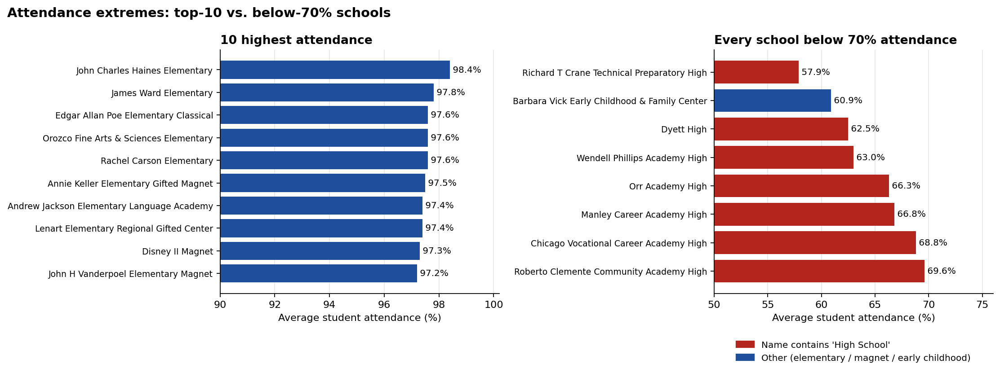
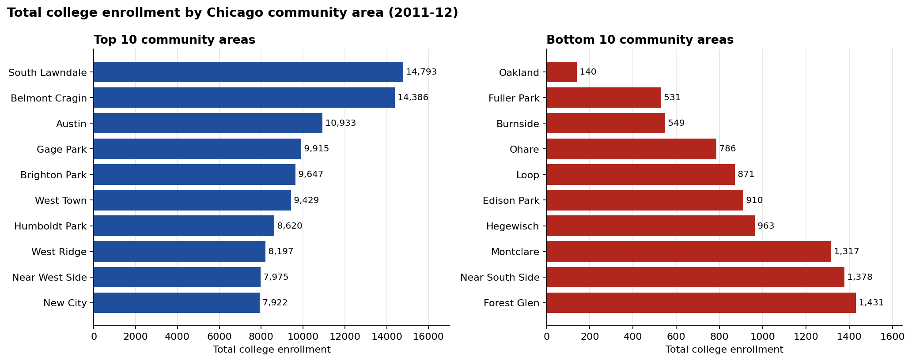
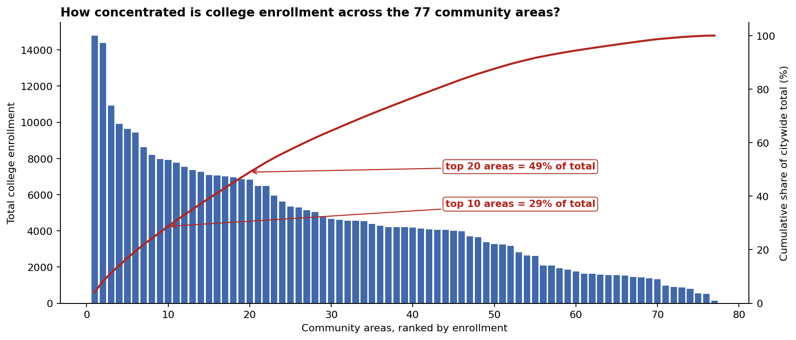
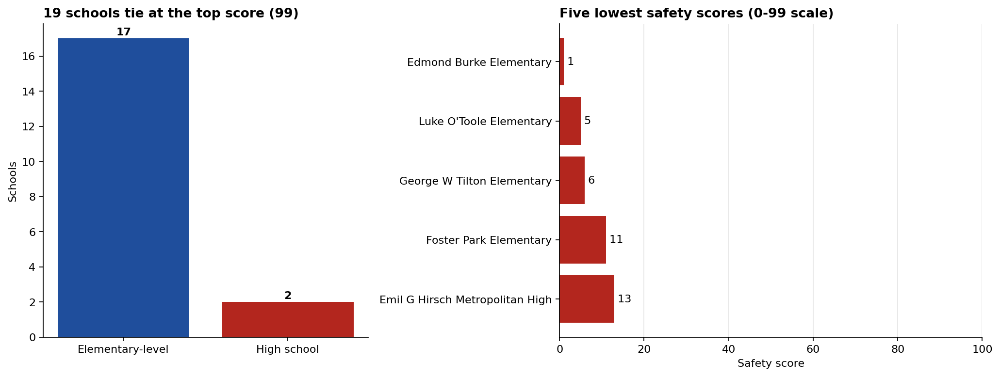

# Chicago Public Schools (2011-12): SQL Analysis of Safety, Attendance and Enrollment

A SQL-driven analysis of the City of Chicago's school progress-report data: **566 schools x 78 columns**, joined to community-area census data. The project loads the raw CSVs into **SQLite**, inspects the schema through the system catalog, and answers 12 analytical questions with filters, aggregates, sub-queries and joins, then interprets what the results mean and which traps a real dataset sets for SQL users.

It began as the IBM *Working with a Real World Data-set using SQL and Python* lab and was extended into a documented, reproducible project.



---

## Key results

| Question | Result |
|---|---|
| Schools in the dataset | **566**, across **78 columns** |
| Elementary schools | **462** (81.6%) |
| Highest safety score | **99**, shared by **19 schools** (17 elementary-level, 2 high schools) |
| Lowest safety score | **1** (Edmond Burke Elementary) |
| Highest average attendance | **98.4%** (John Charles Haines Elementary) |
| Schools below 70% attendance | **8**, of which **7 are high schools** (lowest: Richard T. Crane Technical Prep, **57.9%**) |
| Community areas | **77**, total enrollment **354,346** |
| Largest / smallest area by enrollment | South Lawndale **14,793** / Oakland **140** (**106x** gap) |
| Concentration | Top 10 areas hold **28.7%** of all enrolled students; the 38 smallest hold **24.4%** |
| Hardship index for the largest school's area | **6** (North Center, home of Lane Technical High School) |

### What the data says

1. **Attendance follows school type.** All ten highest attendance rates (97.2-98.4%) belong to elementary-level schools, at least six of them selective programs (Classical, Gifted, Magnet, Language Academy). Of the eight schools below 70%, seven are high schools and one is an early-childhood center: a **40-point spread** between the extremes.
2. **Safety scores use almost the whole scale.** They run from 1 to 99. Both the top-scoring and bottom-scoring groups contain elementary schools and high schools, so school type alone does not explain safety.
3. **Enrollment is highly concentrated and right-skewed.** Mean 4,602 vs. median 4,206 students per area, and the largest area is 106x the smallest. Several of the smallest areas (e.g. O'Hare, the Loop) are not primarily residential.
4. **The biggest school sits in a low-hardship area.** Lane Technical High School (4,368 students) is in North Center, hardship index 6 (on the index's 1-100 scale, higher = more hardship).

<p align="center">
  
</p>

<p align="center">
  
  
</p>

---

## What I did

| Step | Description |
|---|---|
| **1. Load** | Read two CSVs with pandas and wrote them to SQLite with `DataFrame.to_sql()`: `CHICAGO_PUBLIC_SCHOOLS_DATA` (566 rows) and `CENSUS_DATA` (78 rows, one per community area plus any summary row). |
| **2. Inspect the catalog** | Queried `sqlite_master` and `PRAGMA_TABLE_INFO` to list tables, count columns and read declared types: 59 `TEXT`, 12 `REAL`, 7 `INTEGER`. |
| **3. Handle awkward names** | Worked with mixed-case names and the 6 columns containing spaces/commas/parentheses (`"Elementary, Middle, or High School"`) using double-quoted identifiers. |
| **4. Query (12 problems)** | Counting, `MAX`, sub-queries, `ORDER BY ... LIMIT`, `NULLS LAST`, `REPLACE`, `CAST`, `GROUP BY` + `SUM`, and joins across the two tables. |
| **5. Interpret** | Turned each result into a finding and flagged data-quality traps (below). |
| **6. Package** | Moved each query into its own `.sql` file, wrote a pipeline that rebuilds the database and **checks live results against the originals**, added smoke tests and charts. |

### SQL techniques demonstrated

`COUNT / MAX / SUM` &nbsp;|&nbsp; scalar sub-queries (`= (SELECT MAX(...))`) &nbsp;|&nbsp; `IN (SELECT ... ORDER BY ... LIMIT 1)` &nbsp;|&nbsp; `GROUP BY` &nbsp;|&nbsp; `ORDER BY ... NULLS LAST` &nbsp;|&nbsp; `REPLACE` + `CAST` for text-to-number &nbsp;|&nbsp; table-valued `PRAGMA_TABLE_INFO` &nbsp;|&nbsp; implicit and explicit `JOIN`

---

## Data-quality findings (the "real world" part)

| Pitfall | What happened | Safe habit |
|---|---|---|
| **Numbers stored as text** | 59 of 78 columns are `TEXT`; attendance is `'96.00%'`. | `CAST(REPLACE(col,'%','') AS REAL)` before comparing or averaging. |
| **NULLs sort first (ascending)** | Problem 5's "lowest attendance" was *Velma F Thomas Early Childhood Center*, which simply has **no value**. | Filter `IS NOT NULL`, or state `NULLS FIRST/LAST`. |
| **Text sorting is lexicographic** | Correct here only because every value has two digits before the decimal; `'100.00%'` would sort before `'57.90%'`. | Cast to numeric first. |
| **Comparing to the string `'None'`** | The lab's safety filter `!= 'None'` works only because `NULL != x` is `NULL` in SQLite. | Use `IS NOT NULL`. |
| **Ties hidden by `MAX()`** | 19 schools share the top safety score. | `= (SELECT MAX(...))` returns all ties. |
| **Ambiguous question** | "Community area with the highest College Enrollment" can mean the area of the largest *school* (lab answer: North Center) or the area with the largest *total* (South Lawndale). | Say which reading the query implements; `E07` covers the second. |
| **Misleading column name** | `COLLEGE_ENROLLMENT` holds 500-1,300 for elementary schools in the sample, so it behaves like each school's total headcount. | Sanity-check values against sample rows before interpreting. |

---

## Project structure

```
.
├── README.md
├── requirements.txt
├── run_pipeline.py                  # CSV -> SQLite -> run all SQL -> checks, metrics, charts
├── src/chicago_sql.py               # load / query / chart helpers
├── sql/
│   ├── problems/                    # the 12 lab problems, one .sql file each
│   └── extended/                    # 7 additional analysis queries (E01-E07)
├── notebooks/
│   └── Chicago_Schools_SQL_Analysis.ipynb   # narrative walkthrough with results and insights
├── data/                            # schema (78 cols), 8 real sample rows, per-area enrollment totals
├── results/verified_results.json    # outputs of the 12 problems captured from the original run
├── figures/                         # charts used in this README
├── tests/test_queries.py            # smoke test: every .sql file runs against the real 78-column schema
└── original/RealDataPractice_original.ipynb   # the starting lab notebook, untouched
```

## How to run

```bash
pip install -r requirements.txt

# Rebuild the database from the source CSVs (needs internet) and run everything
python run_pipeline.py
#   -> RealWorldData.db, results/live_problems/*.csv, results/extended/*.csv,
#      results/reproduction_check.csv, results/extended_metrics.json, new figures

# Or use local copies of the CSVs
python run_pipeline.py --schools-csv ChicagoPublicSchools.csv --census-csv ChicagoCensusData.csv

jupyter notebook notebooks/Chicago_Schools_SQL_Analysis.ipynb
python tests/test_queries.py
```

`results/reproduction_check.csv` reports, for each of the 12 problems, whether the live result **matches** the output captured in the original run. The notebook works in two modes: without `RealWorldData.db` it displays the captured results; with it, every cell re-runs the SQL live.

## Data

| Table / file | Contents | Source |
|---|---|---|
| `CHICAGO_PUBLIC_SCHOOLS_DATA` | School-level progress-report metrics, 2011-12 (566 x 78) | [Chicago Data Portal](https://data.cityofchicago.org/Education/Chicago-Public-Schools-Progress-Report-Cards-2011-/9xs2-f89t), course-hosted CSV |
| `CENSUS_DATA` | Community-area socioeconomic indicators incl. hardship index | Course-hosted `ChicagoCensusData.csv` |

Because the raw CSVs are downloaded at run time, the repository stores only what the original run produced: the column schema, 8 sample rows, the per-community-area enrollment totals and the outputs of all 12 problems.

## Limitations

- **Scope of reported numbers.** Results above are the 12 lab problems plus statistics derived from their outputs. The extended queries (school-type profile, safety vs. attendance and hardship, area safety rankings, data-completeness audit) are implemented in `sql/extended/` and exercised against the real schema, but **their full-dataset results have not been generated yet**; run `python run_pipeline.py` to produce them.
- **Single school year (2011-12)**; descriptive statistics only, no causal claims.
- **School type for charts is inferred from school names** ("High School" in the name) where the type column was not part of the captured output.
- **Enrollment totals** count students in schools *located* in each area, not residents, and ignore schools with missing values.

## Next steps

- Run the extended queries and add the generated correlation charts (safety vs. attendance, area safety vs. hardship).
- Compare attendance and safety across school types with the full table.
- Add window functions (e.g. rank schools within each community area) and views for repeated logic.

## Tech stack

SQL (SQLite) · Python · pandas · matplotlib · Jupyter

## Credits

Based on the IBM Skills Network lab *Working with a Real World Data-set using SQL and Python*, using data from the City of Chicago Data Portal.
